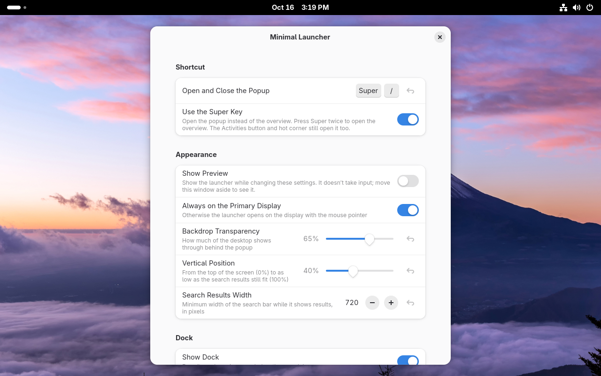

# Minimal Launcher

[](https://github.com/g-freeks/gnome-minimal-launcher/actions/workflows/ci.yml)

[](https://github.com/g-freeks/gnome-minimal-launcher/releases/latest)

A low-distraction application launcher for GNOME Shell that attempts to stay faithful to the GNOME look&feel. It gives you the Activities overview's search bar and dash in a small centered popup, without zooming out to the full-screen window overview.

Press <kbd>Super</kbd> to open it over your windows: the search bar on top, your pinned and running apps below. Press <kbd>Super</kbd> twice for the regular overview. <kbd>Super</kbd>+<kbd>/</kbd> opens it too.


## Features

- **The shell's own search and dash**, so results, providers and theme match the overview.
- **Keyboard first.** Arrows move between and within rows, <kbd>Tab</kbd> jumps from row to row, <kbd>Enter</kbd> opens the top result, <kbd>Esc</kbd> clears and closes.
- **<kbd>Alt</kbd>+<kbd>Tab</kbd>** switches between the running apps in the dock while the launcher is open.
- **Open paths.** Type a path starting with `/` or `~`; <kbd>Tab</kbd> completes it.
- **Run commands** with `run <command>`.
- **Search the web** with `web <terms>`, using your browser's default search engine.


## Requirements

GNOME Shell **49**, **50** or **51**. The extension reuses internal parts of GNOME Shell, so other versions aren't supported until they've been checked.

## Installation

Download `minimal-launcher@g-freeks.github.io.shell-extension.zip` from the [latest release](https://github.com/g-freeks/gnome-minimal-launcher/releases/latest) and install it:

```sh
gnome-extensions install --force minimal-launcher@g-freeks.github.io.shell-extension.zip
```

Log out and back in (on Wayland, GNOME Shell only loads new extensions at login), then enable it in the Extensions app or with:

```sh
gnome-extensions enable minimal-launcher@g-freeks.github.io
```

Installing a newer release works the same way; extensions installed from a file don't update automatically.

### From source

```sh
git clone https://github.com/g-freeks/gnome-minimal-launcher.git
cd gnome-minimal-launcher
make install
make enable
```

## Settings

Open them from the Extensions app, or with `gnome-extensions prefs minimal-launcher@g-freeks.github.io`. They cover the shortcut, the Super key, size and position, the dock and the search additions.



## Development

```sh
npm ci           # dev tooling (ESLint) only; the extension has no dependencies
make check       # lint, validate the schema, check the shell internals we rely on
```

Changes are tested in disposable libvirt VMs, one per GNOME version, that mount this checkout as the installed extension:

```sh
make vm-create             # one-time, unattended install (needs @virtualization and virtiofsd)
make vm-reload             # restart the VM's GNOME session to load your changes
make vm-reload GNOME=49    # the same, on the GNOME 49 VM
vm/vm                      # list the helper commands: eval JS in the shell, send keys, screenshots, logs
```

A `v*` tag publishes a release with the extension zip. [CLAUDE.md](CLAUDE.md) covers the architecture.

## License

GPL-2.0-or-later, the same as GNOME Shell. See [LICENSE](LICENSE).
