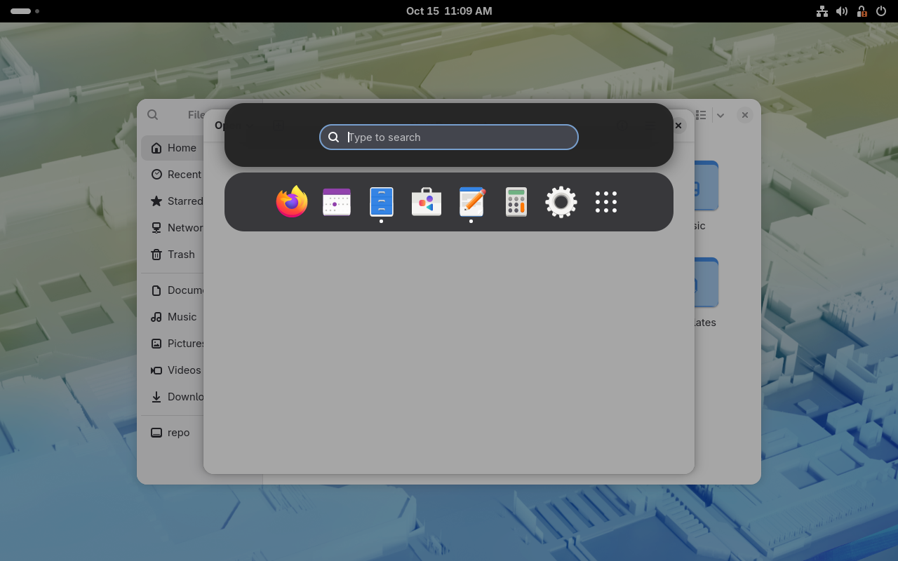
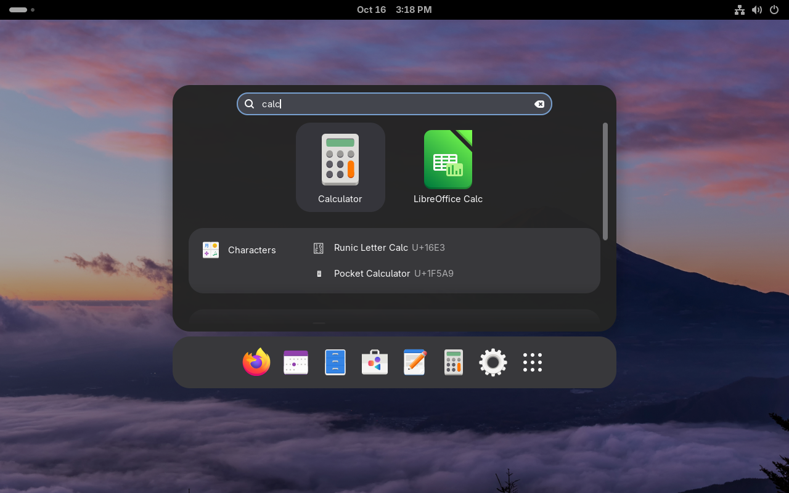

# Minimal Launcher

A low-distraction application launcher for GNOME Shell. It gives you the Activities overview's search bar and dash in a small centered popup, without zooming out to the full-screen window overview.

Press <kbd>Super</kbd> and the popup appears over your current windows: the search bar on top, your pinned and running apps below it. Start typing to search, the same way as in the overview. Press <kbd>Super</kbd> twice for the regular overview. <kbd>Super</kbd>+<kbd>/</kbd> also opens the popup, even with the <kbd>Super</kbd> key behaviour turned off.



## Features

- **The shell's own components.** Search results, search providers and the dash are GNOME Shell's own implementations. They look like the overview and follow your theme.
- **Search as you type.** Results appear in the popup, and <kbd>Enter</kbd> opens the top result.
- **Keyboard navigation.**
  - <kbd>↓</kbd>/<kbd>↑</kbd> move between the search bar, the results and the dash.
  - <kbd>←</kbd>/<kbd>→</kbd> move within a row.
  - <kbd>Tab</kbd> cycles through the results.
  - <kbd>Esc</kbd> clears the search, and closes the popup once the search bar is empty.
- **Switch apps with <kbd>Alt</kbd>+<kbd>Tab</kbd>.** While the launcher is open, <kbd>Alt</kbd>+<kbd>Tab</kbd> steps through the running apps in the dock (<kbd>Shift</kbd> goes back), and releasing <kbd>Alt</kbd> switches to the selected one. <kbd>Esc</kbd> cancels.
- **Closes when you're done.** Launching an app, choosing a result or clicking outside the popup closes it.
- **Open paths.** Type or paste a path starting with `/` or `~` (or a `file://` URI). Open it, or show it in Files. Matching files and folders are suggested, and <kbd>Tab</kbd> completes the path like a terminal does.
- **Run commands.** Type `run` followed by a command, for example `run code ~/project`, and press <kbd>Enter</kbd>. It runs in the background through `/bin/sh` from your home folder. If it fails, a notification shows the end of its error output.
- **App grid hand-off.** The dash's *Show Apps* button opens the regular overview's app grid.
- **Takes over the Super key.** <kbd>Super</kbd> opens the popup instead of the overview, and pressing it twice opens the overview. This can be turned off.

| Searching | Selecting an app from the dash |
|---|---|
|  |  |

## Requirements

GNOME Shell **49** or **50**.

The extension reuses internal parts of GNOME Shell, so other versions are not supported until they've been checked. CI checks every supported version against the real shell release.

## Installation

```sh
git clone https://github.com/g-freeks/gnome-minimal-launcher.git
cd gnome-minimal-launcher
make install
make enable
```

On Wayland, GNOME Shell only loads new extensions at login, so log out and back in after installing.

## Settings

Open the settings from the Extensions app, or run `gnome-extensions prefs minimal-launcher@g-freeks.github.io`.

- **Shortcut.** Default: <kbd>Super</kbd>+<kbd>/</kbd>, which is free in a default GNOME. Any combination can be recorded, including ones GNOME already uses; the first time, GNOME asks whether the Extensions app may inhibit shortcuts while recording. If GNOME already uses the combination, its own shortcut takes precedence, and the settings window warns about it.
- **Use the Super key.** On by default. Pressing <kbd>Super</kbd> on its own opens the popup instead of the overview. Pressing <kbd>Super</kbd> twice quickly opens the overview. The Activities button, the hot corner and <kbd>Super</kbd>+<kbd>A</kbd> also still open it.
- **Show preview.** Shows the launcher while you change settings, so every change is visible right away. The preview doesn't take input; move the settings window aside to see it. It turns off when the settings window closes.
- **Backdrop transparency.** How much of the desktop shows through behind the popup. Default: 65%.
- **Vertical position.** Where the launcher sits, from the top of the screen (0%) to as low as it fits with search results showing (100%). Default: 40%.
- **Show dock.** On by default. Without it the launcher is just the search box.
- **Dock icon size.** 50–200% of the size the dock would pick itself; it still shrinks icons when the dock would get wider than the screen.
- **Dock at bottom of screen.** Shows the dock at the bottom edge, like the overview does, instead of attached below the search bar.

The launcher is as wide as its content. With the dock attached, the search box and dock share the width of the wider one. With the dock at the bottom, each has its own width, and search results get at least the dock's width.
- **Open paths / Run commands.** Turn the two search additions on or off. Both are on by default.

The bottom of the settings window shows the installed version and links to the issue tracker.

## Development

```sh
npm ci           # dev tooling (ESLint) only; the extension has no dependencies
make check       # lint, validate the schema, check the shell internals we rely on
```

The repository includes tooling for disposable development VMs, one per supported GNOME version (Fedora 43 for GNOME 49, Fedora 44 for GNOME 50). They run under libvirt in session mode and mount this checkout as the installed extension, so you can test changes without logging out of your own session:

```sh
make vm-create             # one-time, unattended install (needs @virtualization and virtiofsd)
make vm-reload             # restart the VM's GNOME session to load your changes
make vm-reload GNOME=49    # the same, on the GNOME 49 VM
vm/vm                      # list the helper commands: eval JS in the shell, send keys, screenshots, logs
```

Pushing a `v*` tag builds the extension zip and attaches it to a GitHub release.

[CLAUDE.md](CLAUDE.md) covers the architecture and how the popup reuses the shell's `SearchController` and `Dash`.

## License

GPL-2.0-or-later, the same as GNOME Shell. See [LICENSE](LICENSE).
